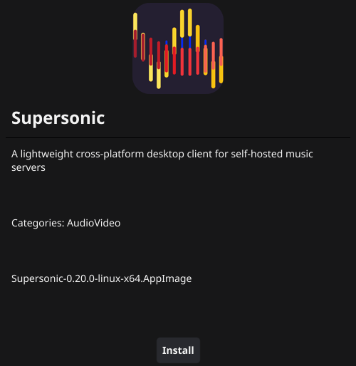

# Appy

A GUI tool for installing and uninstalling AppImage files on Linux. Written in go using the Fyne UI framework.

Once installed, you can double-click AppImage files in your file manager to open them with Appy. Appy will then display the AppImage metadata and provide options to install or uninstall the application.

Installing an AppImage copies it to `~/Applications`, makes it executable, creates a `.desktop` file in `~/.local/share/applications`, and extracts the icon to `~/.local/share/icons/`.

It works completely without root privileges or running daemons and is intended for single-user desktop environments.



### Installation

Download the latest release binary from the [releases page](https://github.com/splitbrain/appy/releases/latest) and run the self-installer:

```bash
chmod +x appy-linux-amd64
./appy-linux-amd64 --install
```

The app will be installed to `~/Applications/appy` and registered as the default handler for AppImage files.

### Uninstallation

To uninstall Appy, run:

```bash
~/Applications/appy --uninstall
```

This removes the Appy binary and its desktop entry.

### Usage

The desktop file association allows you to open AppImage files by double-clicking them in your file manager. You can also run Appy from the command line:

```bash
~/Applications/appy <path-to-appimage-file>
```

When run on an AppImage file outside the `~/Applications` directory, Appy will provide an option to install it. Running it on an already installed AppImage will provide an option to uninstall it.


### Development

See [CLAUDE.md](CLAUDE.md) for detailed development instructions, architecture overview, and testing guidelines etc.

Yes, this has been mostly [vibe engineered](https://simonwillison.net/2025/Oct/7/vibe-engineering/), but I have read and reviewed the code myself (test quality may vary though).

## License

Copyright 2026 Andreas Gohr

Permission is hereby granted, free of charge, to any person obtaining a copy of this software and associated documentation files (the “Software”), to deal in the Software without restriction, including without limitation the rights to use, copy, modify, merge, publish, distribute, sublicense, and/or sell copies of the Software, and to permit persons to whom the Software is furnished to do so, subject to the following conditions:

The above copyright notice and this permission notice shall be included in all copies or substantial portions of the Software.

THE SOFTWARE IS PROVIDED “AS IS”, WITHOUT WARRANTY OF ANY KIND, EXPRESS OR IMPLIED, INCLUDING BUT NOT LIMITED TO THE WARRANTIES OF MERCHANTABILITY, FITNESS FOR A PARTICULAR PURPOSE AND NONINFRINGEMENT. IN NO EVENT SHALL THE AUTHORS OR COPYRIGHT HOLDERS BE LIABLE FOR ANY CLAIM, DAMAGES OR OTHER LIABILITY, WHETHER IN AN ACTION OF CONTRACT, TORT OR OTHERWISE, ARISING FROM, OUT OF OR IN CONNECTION WITH THE SOFTWARE OR THE USE OR OTHER DEALINGS IN THE SOFTWARE.
